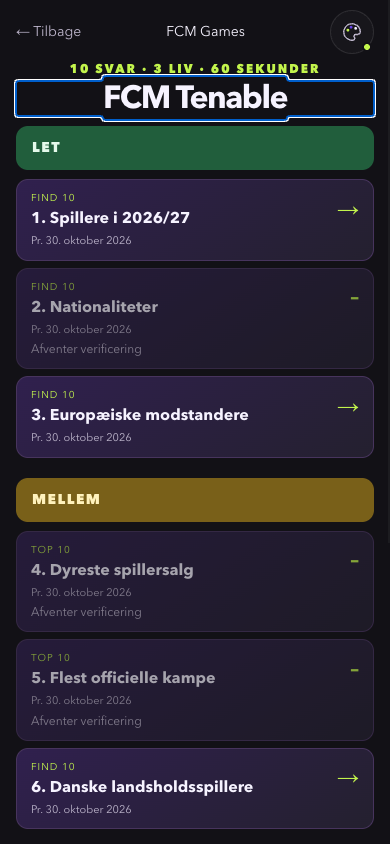
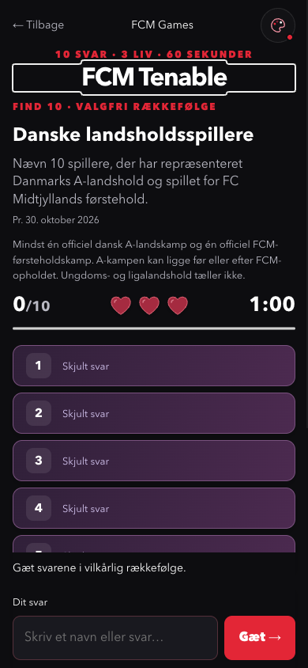

# FCM Tenable

Åbn via forsiden eller `#spil/tenable`. Kataloget har ni faste pladser på én scrollende side: tre under LET, tre under MELLEM og tre under SVÆR. Ingen tabs eller ekstra valgside. Alle udfordringer viser “Pr. 30. oktober 2026”.

Ni udfordringer er spilbare. Landeudfordringen under LET accepterer ti blandt 54 lande fra Transfermarkts tre tabelsider over udenlandske spillere. Den følger tabellens registrering, også uden registrerede kampe, og viser ingen rangering eller spillertal. Dyreste spillersalg bruger den af brugeren oplyste rangliste og eurobeløb, omregnet ved 7,46 DKK/EUR; dette er markeret som brugeroplyst frem for selvstændigt kildeverificeret. Kampranglisten bruger ligeledes brugerens oplyste Transfermarkt Apps-tal og rækkefølge. Den tidligere låste nationalitetsudfordring er erstattet af landeudfordringen. Der vises ingen gættede facitlister. Se [research, afgrænsninger og udeståender](tenable/research-2026-10-30.md) og [facit med kilder](tenable/answers-2026-10-30.md).

## Datastruktur

`src/data/tenable/challenges.json` er den daterede, statiske kilde til kataloget. `productionChallenges.js` eksporterer hele kataloget og filtrerer de verificerede, spilbare udfordringer. Der foretages ingen live-dataopslag fra spillet. TEST-data i `testChallenges.js` bruges kun af automatiserede tests; de tidligere redaktionelle øvelseslister er fjernet.

Hver udfordring indeholder `id`, `number`, `title`, `description`, `difficulty`, `type`, `asOf`, `durationSeconds` og `status`. Status `user-supplied` betyder et eksplicit brugeroplyst facit med dokumenteret proveniens. En låst udfordring har `verificationNote` og ingen `answers`. En spilbar udfordring har `rules`, `source` og `answers` med kilde-URL'er pr. svar. Seneste-lister gemmer datoer og relevant dokumentation som køber/liga eller målminut. FCK-udfordringen har desuden en sammenhængende kampjournal.

- `any10`: mindst ti dokumenterede svar i puljen; ti forskellige svar vinder. Felterne fyldes i gætteorden og er ikke en rangliste.
- `top10`: præcis ti svar i rangorden.
- `latest10`: præcis ti svar, nyeste først. Fælles transferdato sorteres alfabetisk; fælles kampdato efter målminut.

Et svar har `label`, eksplicitte `aliases` og `sources`. Spillere har `kind: 'player'`, cheftrænere har `kind: 'coach'`, og begge accepterer hvert enkelt navneled fra fuldt navn og dokumenterede aliases, inklusive fornavne og mellemnavne. De kan desuden have eksplicitte `surnames`. Asiatiske navne og sammensatte/alternative efternavne angives eksplicit. Listen over svar bestemmer, om et navneled er entydigt. Friday og Etim identificerer eksempelvis samme spiller, mens Morten kræver præcisering, hvis både Morten Skoubo og Morten Rasmussen er korrekte svar. Fulde navne skal entydigt kunne identificere deres eget svar.

## Svar og spilregler

Matcherens Unicode-normalisering fjerner diakritik, udjævner store/små bogstaver, mellemrum, bindestreger, apostroffer og punktummer samt understøtter bl.a. ø, æ, ß, ł, đ og ı. Alternative translitterationer som Loessl og Juelsgaard angives eksplicit. Ingen delstrengs-, staveafstands- eller fuzzy-matching. Klubnavne accepterer også entydige hele ord fra navn og aliases, fx Nottingham eller Forest. Almindelige klubforkortelser som FC, FK og SC accepteres ikke alene. Manchester og City kræver præcisering, når flere klubber matcher. Landenavne kræver eksplicitte identitetsvarianter. Matcher-tests for lande er syntetiske og gør ikke nationalitetsudfordringen spilbar.

Alle kandidater undersøges før et svar accepteres. Et fælles fornavn, mellemnavn, efternavn eller alias giver besked om at skrive fuldt navn og koster intet liv, også hvis én kandidat allerede er gættet. Gentagelser og tomme indtastninger koster heller ikke liv. Forkerte svar og tidsudløb koster ét liv. Runden slutter, når alle tre liv er brugt. Ti forskellige korrekte svar vinder.

Timeren er 60 sekunder pr. svar og bruger et absolut sluttidspunkt. Hvert ikke-tomt indsendt svar nulstiller tiden, også et forkert, gentaget eller tvetydigt svar. Tomme indtastninger nulstiller ikke tiden. Tidsudløb koster ét liv og starter næste svarinterval på 60 sekunder. Ved en inaktiv fane medregnes alle forløbne intervaller, så timeren ikke kan pauses ved at skjule fanen. Fristen kontrolleres ved hvert gæt og ved genaktivering af fanen. Et gæt ved præcis deadline afvises. Afsluttede runder ændres ikke. Åbne udfordringer viser præcis ti felter og kan efter afslutning folde hele svarpuljen ud; ranglister afslører alle ti placeringer.

Navigation, slutskærm, 3 liv og de to temaer bruger den eksisterende komponentstruktur. Mobil har fortsat sticky svarfelt, 16px inputtekst og ingen automatisk åbning af tastaturet ved start. Tenable er fortsat uden statistik, medaljer, leaderboard, Supabase og lagring. Hash-navigation og statiske importer bevarer GitHub Pages-kompatibilitet.

## Kontrol

`npm test`, `npm run lint` og `npm run build`. Tenable-tests findes i `src/game/tenable.test.js` og `src/game/tenableProduction.test.js`. Tests dækker alle ni spilbare katalogpladser. For de ni spilbare udfordringer afprøves samtlige fulde navne, aliases, dubletter, ti-svar-sejr, tidsgrænse og kilde-/datostruktur. Tests verificerer kode og konsistens; historiske fakta dokumenteres af kilderne, ikke af tests alene.

Seneste kontrol: 282 automatiserede tests består; lint og produktionsbuild inklusive PWA-kontrol består. En tidligere isoleret lokal Chrome-kontrol ved præcis **390 × 844 CSS-px** har afprøvet begge temaer, ni kort/fire låste kort, ti felter, tvetydigt navn uden livstab, korrekt svar, dublet, tre fejl og afslutningsskærm. Intet vandret overflow i de kontrollerede skærmbilleder. Den indbyggede browserforbindelse var utilgængelig, så Chrome blev brugt som lokal reserve. Den midlertidige testside er fjernet og indgår ikke i buildet.

